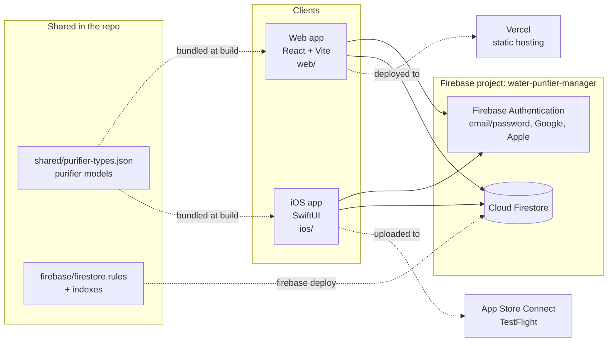

# System Architecture

**Last Updated**: 2026-10-17

Water Purifier Manager has no server of its own. Two client apps — a React web app and a native SwiftUI iOS app — talk directly to Firebase Authentication and Cloud Firestore. Firestore security rules are the only place access is enforced, so they act as the backend's business logic for permissions. See [ADR-0001](../09-decisions/0001-client-only-firebase.md).

## System map



## Components

| Component | Location | Role |
|-----------|----------|------|
| Web app | [`web/`](../../web) | SPA for desktop and mobile browsers; also hosts the `/invite/:id` page that invite links open |
| iOS app | [`ios/`](../../ios) | Native iPhone app (iOS 17+); adds local filter-replacement reminders |
| Shared data | [`shared/purifier-types.json`](../../shared/purifier-types.json) | The purifier model catalog (filters and default intervals), bilingual; bundled into both apps |
| Firebase config | [`firebase/`](../../firebase) | Firestore rules, indexes, emulator config, rules tests, seed and migration scripts |
| Firebase Authentication | Firebase project | Identity: email/password, Google, Sign in with Apple |
| Cloud Firestore | Firebase project | All user data; realtime listeners keep both apps in sync |
| Vercel | — | Builds `web/` and serves it at https://water-purifier-manager.vercel.app; preview deploys per PR |
| App Store Connect | — | iOS builds distributed via TestFlight |

## Data in one picture

```
purifiers/{purifierId}                 owner (userId) + shared members (memberIds, roles)
├── filters/{filterId}                 one per cartridge: interval + lastReplacedAt
└── logs/{logId}                       history: who created the purifier, who replaced what
invites/{inviteId}                     pending/used invites; the id is the secret in the link
activityLogs/{logId}                   legacy history from before sharing (owner-only, read-only)
```

Details: [`../05-specs/database/`](../05-specs/database/README.md).

## Key properties

- **Realtime** — both apps subscribe to Firestore snapshots, so a filter replaced on iOS appears on the web immediately.
- **Same schema, same rules** — the apps write identical documents; [`firebase/firestore.rules`](../../firebase/firestore.rules) enforces owner/editor/viewer access for both.
- **Status is computed, not stored** — OK / due soon / expired is derived on the client from `lastReplacedAt + intervalMonths`; web and iOS implement the same rule ([filters requirements](../02-requirements/functional/filters.md)).
- **No push server** — reminders on iOS are local notifications scheduled on the device ([ADR-0007](../09-decisions/0007-local-notifications-for-reminders.md)).

## Related

- Tech stack → [tech-stack.md](tech-stack.md)
- Web and iOS internals → [`../03-architecture/`](../03-architecture/README.md)
- Diagrams → [`../03-architecture/diagrams/`](../03-architecture/diagrams/README.md)
