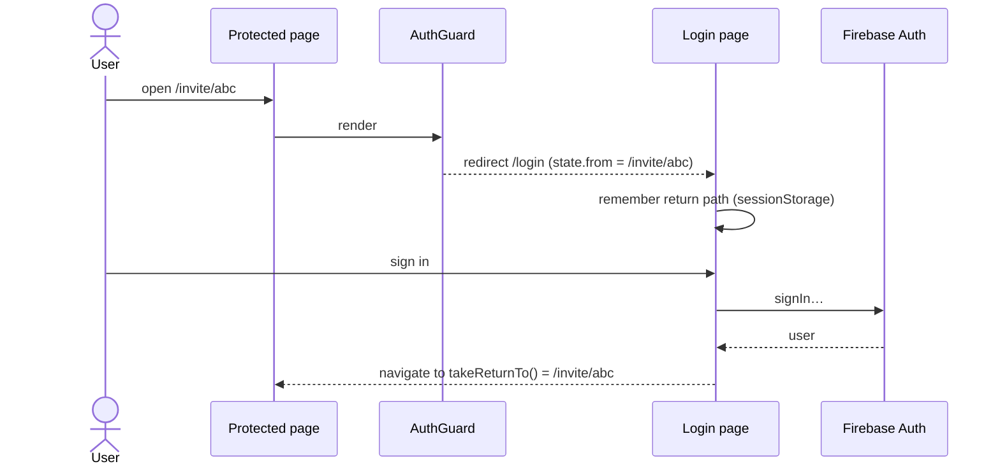

# Authentication Architecture

**Last Updated**: 2026-10-17

Firebase Authentication is the only identity provider. Both apps sign users in with the Firebase SDK; Firestore rules then see `request.auth.uid` (and, for email invites, `request.auth.token.email` / `email_verified`). There are no custom tokens or sessions.

## Providers

| Provider | Web | iOS |
|----------|-----|-----|
| Email/password | `createUserWithEmailAndPassword`, `signInWithEmailAndPassword`, `sendPasswordResetEmail` | Same APIs in Swift |
| Google | `signInWithPopup`; `signInWithRedirect` in embedded webviews (user agent matches Zalo, FBAN/FBAV, Instagram, LINE, MicroMessenger, WebView); `getRedirectResult` on load | GoogleSignIn SDK → `GoogleAuthProvider.credential(idToken, accessToken)` → `Auth.signIn(with:)`; client id from `GoogleService-Info.plist` |
| Apple | — | `SignInWithAppleButton` with a SHA-256 nonce → `OAuthProvider.appleCredential(idToken, rawNonce, fullName)` |

## Web flow

`AuthProvider` subscribes to `onAuthStateChanged`; `AuthGuard` shows a spinner while loading. Firebase persists the session in IndexedDB.

## iOS flow

`AuthSession` listens to auth state. Google and Apple sign-in are started from `SignInView`; errors are mapped to localized messages by `AuthErrorMessage`, and cancellations are silent. On sign-up and first Apple sign-in the display name is set with a profile change request. Signing out also signs out of Google and removes pending reminders.

## Identity in data

| Where | Field | Source |
|-------|-------|--------|
| Owner of a purifier | `purifiers.userId` | `uid` |
| Owner's visible name | `purifiers.ownerName` | display name or email, written when the owner creates an invite |
| Member profile | `purifiers.memberProfiles[uid]` | display name or email, written by the member when joining |
| Invite creator | `invites.createdBy`, `createdByName` | owner |
| History actor | `logs.actorId`, `actorName` | the user performing the action |

Clients cannot look up other users, so names are copied into documents at the moment they are needed.

## Configuration

- Web: `VITE_FIREBASE_*` in `web/.env.local` (git-ignored).
- iOS: `GoogleService-Info.plist` and `Config/Firebase.xcconfig` (`GOOGLE_REVERSED_CLIENT_ID` URL scheme), both git-ignored; Sign in with Apple entitlement in `Config/WaterPurifierManager.entitlements`.
- Firebase console: Email/Password, Google and Apple providers enabled; the OAuth consent screen's app name is what Google shows during sign-in.

## Related

- Requirements → [FR-001](../02-requirements/functional/authentication.md)
- Integrations → [Firebase Auth](../05-specs/integrations/firebase-auth.md), [Google Sign-In](../05-specs/integrations/google-sign-in.md), [Sign in with Apple](../05-specs/integrations/sign-in-with-apple.md)
- Access control → [`../08-security/access-control.md`](../08-security/access-control.md)
