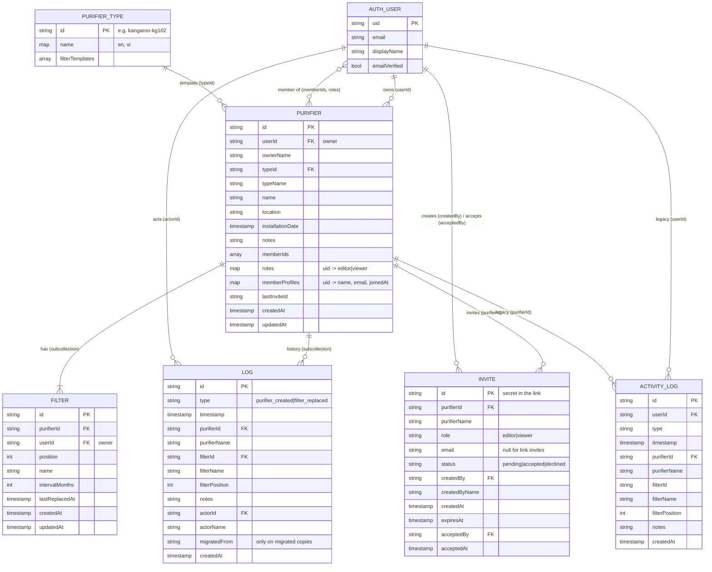

# Data Model (ER)

**Last Updated**: 2026-10-17

Firestore is schemaless; this is the shape both apps write. Users are Firebase Auth accounts, not documents. Purifier types live in `shared/purifier-types.json`.

## Related

- Per-collection specs → [`../../05-specs/database/`](../../05-specs/database/README.md)
