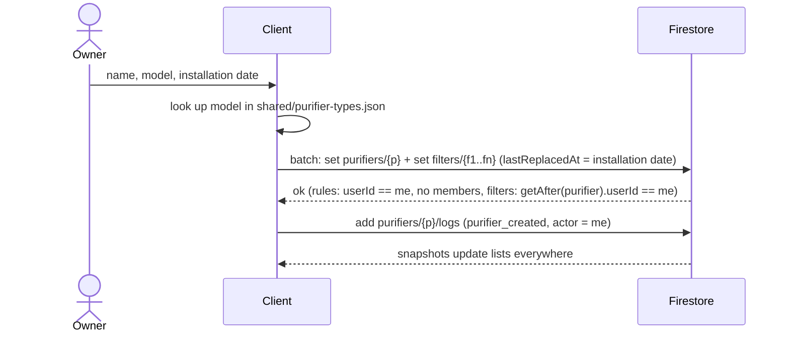
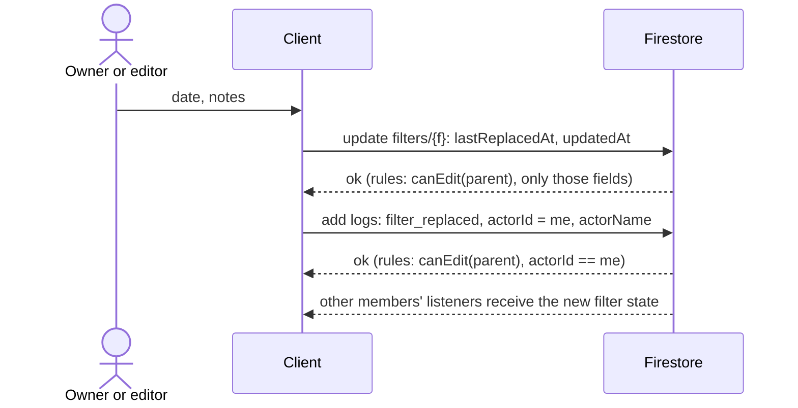
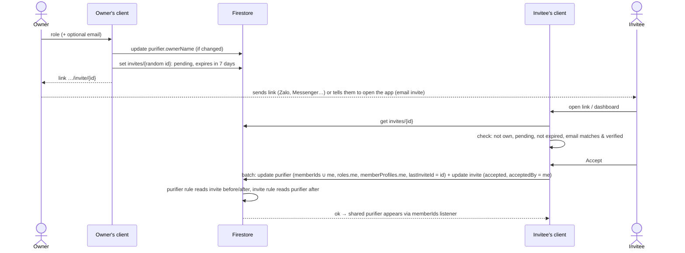
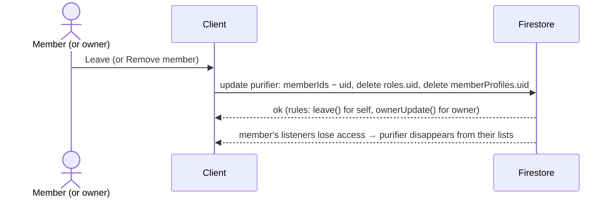

# Sequence Diagrams

**Last Updated**: 2026-10-17

The main write flows. "Client" is either app; both send the same writes.

## Create a purifier

## Replace a filter

## Invite and accept

A removed member cannot reuse their old invite: the purifier rule requires the invite to be `pending` *before* the batch.

## Leave or remove

## Related

- Data access → [`../data-access.md`](../data-access.md)
- Rules → [`../../08-security/access-control.md`](../../08-security/access-control.md)
