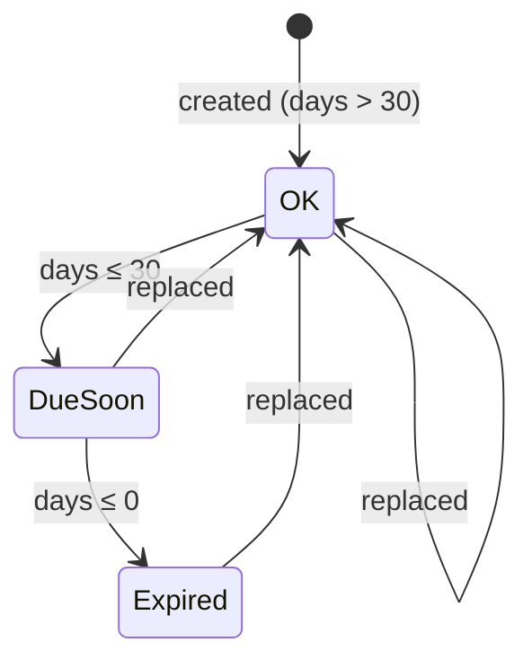

# State Diagrams

**Last Updated**: 2026-10-17

## Filter status

Computed, never stored. `days` = whole days until `lastReplacedAt + intervalMonths`.

A filter with a 1-month interval can start in *Due soon* (a 28–30-day month is ≤ 30 days). Replacing restarts the clock from the replacement date, which may be in the past.

## Invite lifecycle

```mermaid
stateDiagram-v2
    [*] --> pending: owner creates (expiresAt = now + 7 days)
    pending --> accepted: invitee joins (same batch adds them to the purifier)
    pending --> declined: email invitee declines
    pending --> [*]: owner revokes (document deleted)
    pending --> expired: expiresAt passes
    accepted --> [*]
    declined --> [*]
    expired --> [*]: (still stored; unusable)
```

`expired` is not a stored status: the document stays `pending` and every check compares `expiresAt` with the current time. Deleting a purifier deletes its invites.

## Related

- Filter rule → [`../../02-requirements/functional/filters.md`](../../02-requirements/functional/filters.md#status-rule)
- Invites → [`../../05-specs/database/invites.md`](../../05-specs/database/invites.md)
