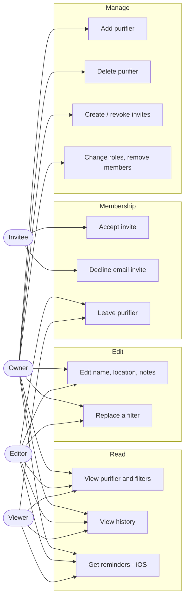

# Use Cases

**Last Updated**: 2026-10-17

Who can do what. Every signed-in user is an owner of the purifiers they create and may be an editor or viewer of others.

## Related

- Access matrix → [`../../02-requirements/functional/sharing.md`](../../02-requirements/functional/sharing.md#access-matrix)
