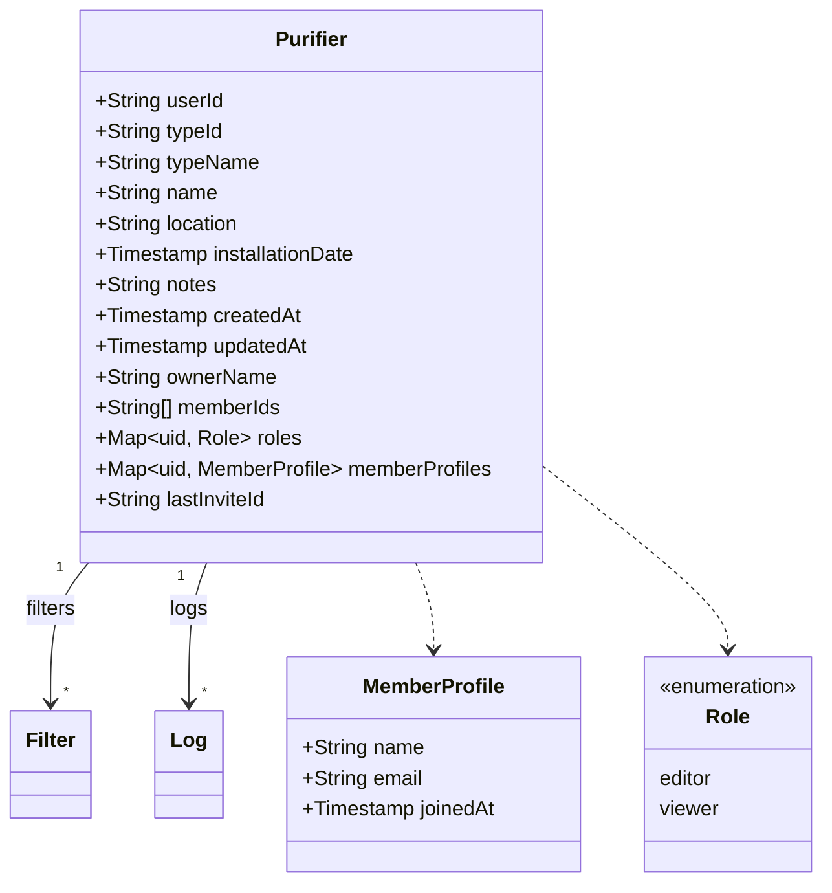

# Purifiers

**Collection**: `purifiers`
**Types**: `Purifier` in `web/src/types/index.ts`, `ios/WaterPurifierManager/Models/Purifier.swift`
**Last Updated**: 2026-10-17

## Description

A water purifier a user tracks. The creator is its owner (`userId`). Sharing adds members in `memberIds` with a role each; the owner is never listed there. Parent of [`filters`](filters.md) and [`logs`](logs.md).

## Fields

| Field | Type | Required | Description |
|-------|------|----------|-------------|
| `userId` | string | ✅ | Owner's uid. Never changes. |
| `typeId` | string | ✅ | Catalog model id, e.g. `kangaroo-kg102` |
| `typeName` | string | ✅ | Model name in the creator's language at creation (fallback when the id isn't in the catalog) |
| `name` | string | ✅ | 1–100 characters |
| `location` | string | ✅ | ≤ 200 characters; `""` when empty |
| `installationDate` | timestamp | ✅ | Chosen by the user; first `lastReplacedAt` of every filter |
| `notes` | string | ✅ | ≤ 500 characters; `""` when empty |
| `createdAt` | timestamp | ✅ | Client time at creation; list order |
| `updatedAt` | timestamp | ✅ | Client time of the last edit |
| `ownerName` | string | — | Owner's display name or email, written when the owner creates an invite |
| `memberIds` | array\<string\> | — | Uids of shared members (max 20, never the owner) |
| `roles` | map\<uid, `"editor"`\|`"viewer"`\> | — | One entry per member; keys equal `memberIds` |
| `memberProfiles` | map\<uid, { `name`, `email`, `joinedAt` }\> | — | Written by each member when they join; keys ⊆ `memberIds` |
| `lastInviteId` | string | — | Id of the invite used by the most recent join; lets the rules verify it |

Sharing fields are absent on purifiers that were never shared.

## Diagram

## Access

| Operation | Who | Notes |
|-----------|-----|-------|
| Read | Owner, members | Queries: `userId == me` (owned), `memberIds array-contains me` (shared) |
| Create | Anyone signed in | Must set `userId` = self and no sharing fields |
| Update | Owner | Anything, as long as `userId` stays and membership stays valid |
| Update | Editor | Only `name`, `location`, `notes`, `updatedAt` |
| Update | Member | Remove only themselves (leave) |
| Update | Invitee | Add only themselves, in the same batch that accepts a valid invite |
| Delete | Owner | Clients delete filters, logs and invites first |

## Written by

- Create: `purifierService.create` / `PurifierRepository.create` (batch with filters)
- Edit: `purifierService.update` / `PurifierRepository.update`
- Sharing: `sharingService` / `SharingRepository` (`createInvite` sets `ownerName`; `acceptInvite`, `changeRole`, `removeMember`)

## Related

- Requirements → [FR-002](../../02-requirements/functional/purifiers.md), [FR-009](../../02-requirements/functional/sharing.md)
- Rules → [`../../08-security/access-control.md`](../../08-security/access-control.md)
